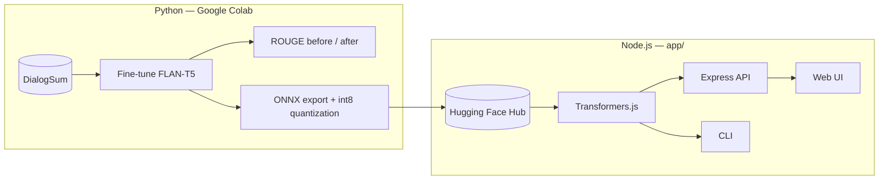
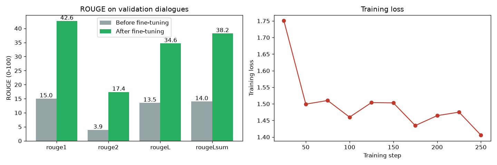

# Dialogue Summarizer

Summarize conversations — chats, support tickets, meeting talk — into one or two sentences.

A FLAN-T5 model is fine-tuned on the [DialogSum](https://huggingface.co/datasets/knkarthick/dialogsum) dataset in Python, exported to ONNX with int8 quantization, and served from a **Node.js / Express** app with [Transformers.js](https://huggingface.co/docs/transformers.js). The model runs on the app's own CPU: no GPU and no paid API at inference time.

[](https://colab.research.google.com/github/jamir-hossain/dialogue-summarizer/blob/main/notebooks/Dialogue_Summarizer_FineTune.ipynb)



## Results

Verification run: `google/flan-t5-small`, 2,000 training dialogues, 1 epoch, CPU (25 minutes of training). ROUGE is measured on 100 validation dialogues the model never saw during training.

| Metric | Before fine-tuning | After fine-tuning |
|---|---|---|
| ROUGE-1 | 15.0 | **42.6** |
| ROUGE-2 | 3.9 | **17.4** |
| ROUGE-L | 13.5 | **34.6** |
| ROUGE-Lsum | 14.0 | **38.2** |



The notebook's default settings (`flan-t5-base`, 4,000 dialogues, 2 epochs on a free T4 GPU) are expected to score higher.

Example (a dialogue that is not in the dataset):

| | |
|---|---|
| **Dialogue** | #Person1#: Hi Rafi, are you coming to the team meeting at 3 pm?<br>#Person2#: I can't, my bus broke down near Farmgate. I'll be at least an hour late.<br>#Person1#: No problem. Should I record the meeting for you?<br>#Person2#: Yes please, and send me the slides too.<br>#Person1#: Sure, I'll email everything after the meeting. |
| **Model summary** | Rafi is coming to the team meeting at 3 pm. #Person1# will send the slides to Rafi. |

**Known limitation:** the small model sometimes gets facts wrong. In the example above it says Rafi *is* coming, but Rafi can't make it. It also swaps who did what in some dialogues. ROUGE only measures word overlap, so it doesn't catch these errors. A larger base model and more training data reduce them, but important summaries still need a human check.

### Model size and speed in Node.js

| dtype | ONNX size | Time for the example above (CPU) |
|---|---|---|
| `fp32` | ~374 MB | 285 ms |
| `q8` (default) | ~95 MB | 228 ms |

The `fp32` ONNX output matches the PyTorch output word for word. `q8` is about 4x smaller, with slightly different wording.

## Project structure

```
dialogue-summarizer/
├── notebooks/
│   └── Dialogue_Summarizer_FineTune.ipynb   # train → ROUGE → ONNX → Hugging Face Hub
├── docs/results.png
└── app/                                     # Node.js app
    ├── src/
    │   ├── summarizer.js    # loads the ONNX model with Transformers.js
    │   ├── validate.js      # request validation
    │   ├── server.js        # Express API + static web UI
    │   └── cli.js           # command-line usage
    ├── public/              # web UI (HTML/CSS/JS)
    ├── tests/               # node --test
    ├── models/              # exported model goes here (not committed)
    └── Dockerfile
```

## 1. Train the model (Python)

Open the notebook in Colab (badge above) and choose **Runtime → Change runtime type → T4 GPU**, then run all cells. The notebook:

1. loads DialogSum and a subset of the training split
2. measures baseline ROUGE, then fine-tunes with `Seq2SeqTrainer`
3. measures ROUGE again and plots the results
4. exports the model to ONNX (`optimum-cli`) and quantizes it to int8
5. uploads the exported model to your Hugging Face account, or downloads it as a zip

Change `MODEL_CHECKPOINT`, `TRAIN_SAMPLES` or `NUM_EPOCHS` in the configuration cell to trade training time for quality.

## 2. Run the app (Node.js 20+)

```bash
cd app
npm install
```

Point the app to the model, using either of these:

```bash
# a) the folder exported by the notebook, copied into app/models/
cp -r /path/to/dialogue-summarizer-onnx models/

# b) the model on the Hugging Face Hub (downloaded and cached on first run)
export MODEL_ID=your-hf-username/dialogue-summarizer-onnx
```

Then start it:

```bash
npm start          # web UI and API at http://localhost:3000
npm test           # 5 tests; the model test is skipped when no model is found
```

Command line:

```bash
node src/cli.js dialogue.txt
cat dialogue.txt | node src/cli.js
```

### API

| Method | Path | Description |
|---|---|---|
| `GET` | `/api/health` | Server status and whether the model has loaded |
| `POST` | `/api/summarize` | Body `{ "text": "...", "maxTokens": 96 }` → `{ "summary", "ms", "model" }` |

```bash
curl -X POST http://localhost:3000/api/summarize \
  -H "Content-Type: application/json" \
  -d '{"text": "#Person1#: Can you pick up Ayesha from school today?\n#Person2#: Sure, what time does her class end?\n#Person1#: At 4:30."}'
```

The text must be 20–8,000 characters long, and `maxTokens` must be between 16 and 256. Invalid requests return `400` with an error message.

### Configuration

| Variable | Default | Description |
|---|---|---|
| `MODEL_ID` | `dialogue-summarizer-onnx` | Folder in `app/models/` or a Hugging Face Hub repo id |
| `DTYPE` | `q8` | `q8` (quantized) or `fp32` |
| `PORT` | `3000` | HTTP port |
| `MODEL_CACHE_DIR` | Transformers.js default | Where Hub downloads are cached |
| `INPUT_PREFIX` | `summarize: ` | Must match the prefix used in training |

## 3. Deploy (optional)

`app/Dockerfile` targets [Hugging Face Spaces](https://huggingface.co/docs/hub/spaces-sdks-docker) (port 7860). Create a Docker Space, upload the contents of `app/`, and set the `MODEL_ID` variable to your Hub model.

## Tech stack

Python · Hugging Face Transformers & Datasets · Evaluate (ROUGE) · Optimum / ONNX Runtime · Node.js · Express · Transformers.js

## License

[MIT](LICENSE)
